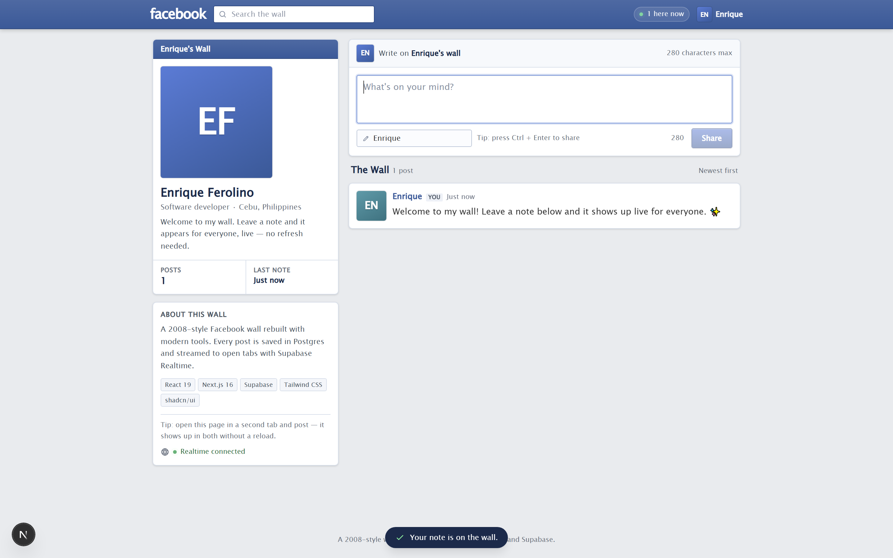
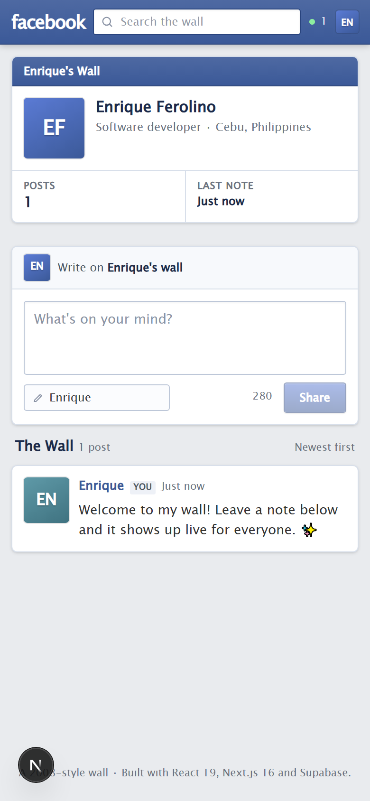

# My Wall

A 2008-style Facebook wall rebuilt with modern tools. Leave a note, and it
appears for everyone in real time — no refresh needed.

**Stack:** React 19 · Next.js 16 · Supabase (Postgres + Realtime) · Tailwind CSS 4 · shadcn/ui

## Live demo

- Production: https://fbmy-wall.vercel.app/
- Repository: https://github.com/zinfotech1996-ui/fbmy-wall

## Screenshots

| Desktop | Mobile |
| --- | --- |
|  |  |

## Features

- **Post a note** — text input with a 280 character counter and Share button.
- **Live feed** — newest posts on top, with relative timestamps and a
  "you" badge on your own notes.
- **Realtime** — new posts stream in over Supabase Realtime; open a second
  tab to watch it happen.
- **Your name** — optional, stored on this device only. Falls back to
  "Guest".
- **Search** — filters the feed by author or message text.
- **Pagination** — loads older notes in pages of 30.
- **2008 Facebook look** — blue top bar, white cards, Verdana/Lucida
  typography, blue links.
- **Responsive** — works on phones and desktops.
- **Accessible** — keyboard (Ctrl/Cmd+Enter to share), labelled controls,
  aria-live feed, reduced-motion support.
- **Resilient** — works without the optional `profiles` table; shows a clear
  setup panel when the database isn't configured.

## How it works

```
Browser (React 19 client component)
  ├─ reads/writes public.posts via the Supabase JS client
  ├─ subscribes to postgres_changes INSERT on public.posts
  └─ tracks presence to show "N here now"
Supabase (Postgres + RLS + Realtime)
```

- `posts` is the only required table (`id`, `user_id`, `body`, `created_at`).
- `profiles` is optional and only adds display names.
- Row level security allows anyone to read and post, while keeping bodies
  between 1 and 280 characters.

## Getting started

### 1. Install

```bash
npm install
cp .env.example .env.local
```

### 2. Create a Supabase project

1. Create a project at [supabase.com](https://supabase.com).
2. Open **SQL Editor → New query**, paste the contents of
   [`supabase/schema.sql`](./supabase/schema.sql), and run it.
3. Copy **Project URL** and **anon public key** from
   Project Settings → API.

### 3. Configure environment

`.env.local`:

```env
NEXT_PUBLIC_SUPABASE_URL=https://your-project.supabase.co
NEXT_PUBLIC_SUPABASE_ANON_KEY=your-anon-key
NEXT_PUBLIC_SITE_URL=http://localhost:3000
```

The newer `sb_publishable_...` keys also work via
`NEXT_PUBLIC_SUPABASE_PUBLISHABLE_KEY`.

### 4. Run

```bash
npm run dev
```

Open [http://localhost:3000](http://localhost:3000).

## Project structure

```
src/
  app/                layout, page, globals.css, icon, opengraph image
  components/
    ui/               shadcn/ui (button, textarea, utils)
    wall/             top bar, profile card, composer, post card, wall
  lib/
    identity.ts       per-browser id + display name store
    supabase.ts       browser client + configuration check
    time.ts           relative timestamp formatting
    wall.ts           queries, realtime, presence
supabase/schema.sql   exact posts table + optional profiles + RLS + realtime
```

## Database

The `posts` table matches the challenge brief exactly:

```sql
create table posts (
  id uuid primary key default gen_random_uuid(),
  user_id uuid,
  body text check (char_length(body) <= 280),
  created_at timestamptz default now()
);
```

The schema file adds an index, RLS policies, an optional `profiles` table,
and adds `posts` to the `supabase_realtime` publication.

## Deployment (Vercel)

1. Push the repository to GitHub.
2. Import the repo on [vercel.com/new](https://vercel.com/new).
3. Add the environment variables:
   - `NEXT_PUBLIC_SUPABASE_URL`
   - `NEXT_PUBLIC_SUPABASE_ANON_KEY`
   - `NEXT_PUBLIC_SITE_URL` (your production domain)
4. Deploy. No build configuration is required.

## Notes

- There is no authentication by design. Each browser gets a stable id in
  `localStorage`; display names are optional and per-device.
- The `profiles` table is optional. If it is missing, posts still load and
  authors show as "Guest".
- The wall is public and unmoderated by design for the challenge. A
  production version would add rate limiting and moderation.
- Reduced motion is respected; animations are disabled when requested.

## Built for

CapM / Semprove — Test 2: My Wall React App.
Previous test: Tic-Tac-Toe (React + Next.js).
